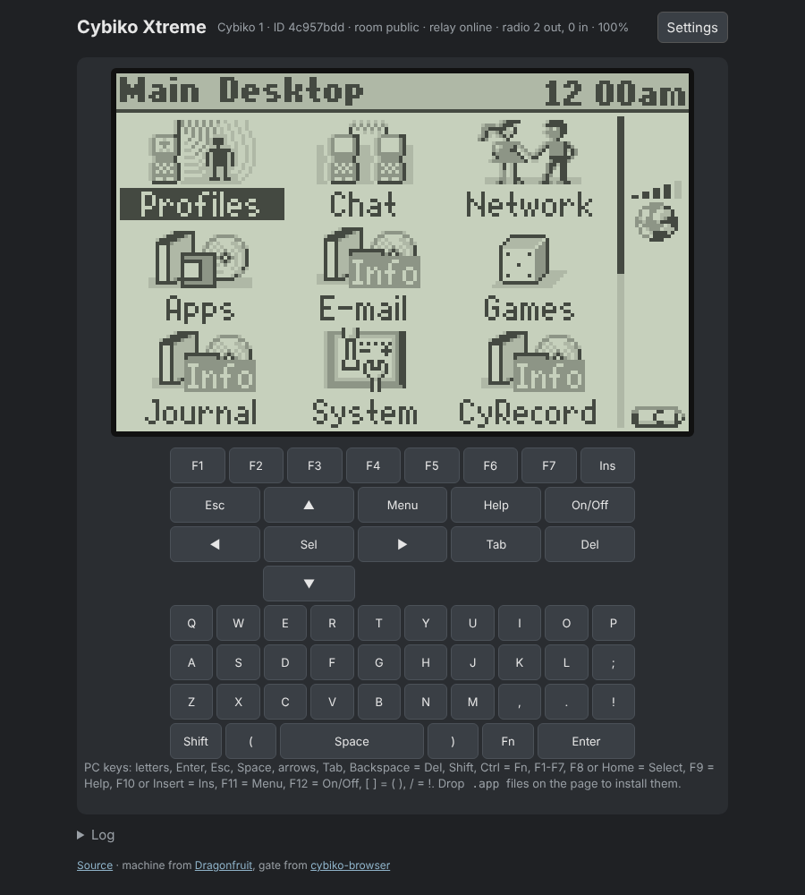
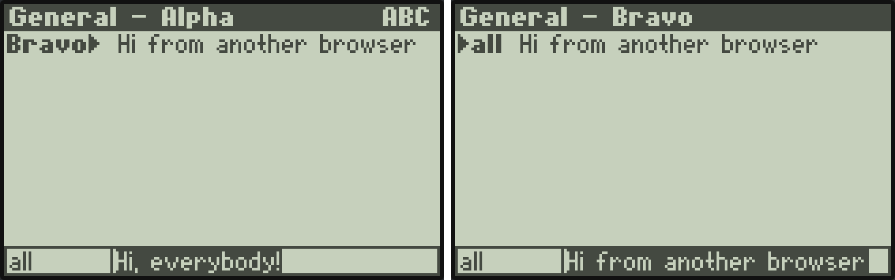
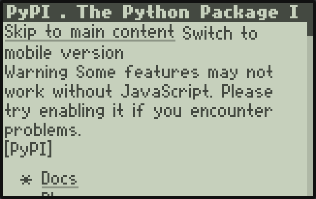

# Cybiko Xtreme in the browser

A Cybiko Xtreme emulator that runs in a web page, with what made the Cybiko
fun: **the radio** (Chat, games and messages between every Cybiko in the
same room, in other tabs or other people's browsers) and **the internet**
through an emulated Cybiko Wireless Internet Gate (CyWIG), for the native
Browser app and the Xtreme WAP browser.

| Chat between two browsers | The Browser app through the gate |
| --- | --- |
|  |  |

It is the same C as the [Dragonfruit](https://github.com/SovGVD/Dragonfruit-JC4827W543-esp32)
board's Cybiko emulator (H8S/2323 core and Cybiko peripherals) and the
[cybiko-browser](https://github.com/SovGVD/cybiko-browser) gate, built to
WebAssembly. Both are submodules in `deps/`.

## Using it

1. Open the page (GitHub Pages, or your own copy, see below).
2. Press **Start the Cybiko**. The page fetches the boot ROM (`cyrom150.bin`)
   and flash (`cyos_v1508.bin`, CyOS 1.5.08) from
   [cybiko-roms](https://github.com/SovGVD/cybiko-roms) (`SITE.files` in
   `web/config.js`) and keeps them in your browser (IndexedDB); tick Russian
   CyOS to get the Russian 1.5.08 update too. "Use my own files instead"
   takes your own dumps, MAME's Cybiko set (`cybikov1.zip`) or a `*.boot`
   update; nothing is uploaded.
3. CyOS boots. Keys: the on-screen keyboard (Shift and Fn latch: tap them,
   then the key; while one is on, or the PC's Shift or Ctrl is held, the keys
   show what they type: capitals, or the digits and symbols Fn gives; with
   the Russian CyOS they show Cyrillic and follow its Fn+Space switch) or the PC keyboard: letters, Enter, Esc, Space, arrows, Tab,
   Backspace = Del, Shift, Ctrl = Fn, F1-F7, F8/Home = Select, F9 = Help,
   F10/Insert = Ins, F11 = Menu, F12 = On/Off, `[` `]` = `(` `)`, `/` = `!`.
4. **Get apps, games and the MP3 player** (under the keyboard) lists the
   software from the Cybiko CDs in cybiko-roms: tick, Install, and the
   Cybiko restarts with it. The MP3 player entry also plugs the cartridge in.
5. Drop `.app` (or any) files on the page, or tap "Add files to the Cybiko", to put them on the Cybiko: it saves
   and restarts (CyOS reads its disk only at power-on), and a note above the
   screen says what was copied. Apps appear at the end of the Main desktop.

EZ Loader installers (`.cap`, `.csu`, such as those on the
[Xtreme Installation CD](https://archive.org/details/CybikoXtremeInstallationCD))
are unpacked as they are added. Games and apps: the
[cybiko.net mirror](https://mirror.jcx.life/cybiko/) and the Internet
Archive ([1](https://archive.org/details/cybiko),
[2](https://archive.org/details/cybiko-applications-games-and-install-cd)).
The page has the same guide under the keyboard.

Settings also has:

- **Download backup / Restore backup**: the whole RAM disk of this tab's
  Cybiko as one file (`ramdisk.bin`), to keep or move to another browser.
- **MP3 cartridge**: a card kept in the browser. When the cartridge is in (Settings, or files on the card) and the Cybiko lacks its software, the page installs `MP3.cap` from cybiko-roms by itself (a checkbox in Settings turns that off). Add MP3s, MXD clips or a
  folder (as you would copy them to the real card) and the Cybiko sees the
  cartridge after a restart, so the MP3 Player and clips play with sound.
  What CyOS does on the card (File Manager's Delete, files it writes or
  renames) is kept in the browser too.
  The cartridge's software must be on the Cybiko: `MP3.cap` from the MP3
  cartridge's own CD (`sdflash.dl` 21.1.4). The `MP3.cap` on the Xtreme
  Installation CD (`sdflash.dl` 21.1.3) stops after reading the card's size and
  never shows the card; the Log says so when one is added.

A copy of the dumps, both CDs and the cartridge software is kept in
[cybiko-roms](https://github.com/SovGVD/cybiko-roms).
- **Files on the Cybiko**: the list; click a file to download it.

The clock runs on your computer's time (CyOS shows the year as 2002-2005:
the clock chip only keeps the year mod 4). The beeper has its real duty
cycle, mixed with the cartridge's sound.

The RAM disk (4 MB by default, Settings) and a reprogrammed flash are saved
every few seconds. The screen uses integer zoom only.

**Every tab is a Cybiko of its own.** The first tab is Cybiko 1, a second
tab Cybiko 2, and so on, each with its own RAM disk and Cybiko ID (CyOS
ignores packets from its own ID, so two tabs sharing one could not chat).
The ROM and flash dumps are shared.

## Radio

What CyOS sends to its radio co-processor (`cy_rf.c`) goes out as raw
packets, framed with a tab id and sequence number (9 bytes, then the 50- or
200-byte packet):

- to the other tabs of the same browser over a `BroadcastChannel`, which
  needs no server;
- to everyone in the same **room** over the relay's WebSocket
  (`/room/NAME`), when a proxy URL is set and "Join the room over the relay"
  is on.

A packet heard both ways is taken once. Rooms are like being in range of each
other: everyone in a room hears everyone else, nobody else hears them. The
default room is `public`. Real Cybikos are out of reach (their air protocol
is unknown). The emulator is standalone: it does not talk to Dragonfruit boards.

The dot above the screen is the Cybiko's **status LED**. As on a real Xtreme
it blinks red while the radio sends and green while it hears another Cybiko
(or the gate), so with others in the room it blinks green every few seconds
as they ping.

## Internet: the gate and the proxy

Every tab runs its own CyWIG gate that only its own Cybiko hears, so the
Browser app (installed automatically) and the Xtreme WAP browser find a gate
nearby. Browsers cannot fetch other sites directly (CORS), so the gate fetches
through a small proxy (`proxy/`), one redirect step at a time so each step
gets its cookies:

    GET|POST /fetch?url=URL   (cookies in X-Cookie)
    -> 200, body, X-Status, X-Location, X-Content-Type, X-Final-Url, X-Set-Cookie

With no proxy set, the gate still answers but every page says
"No proxy set". Everything the gate, radio and CyOS (its SCI1 console) do is
in the Log panel under the screen.

### Cloudflare Worker (the public proxy and relay)

`proxy/worker.mjs` is the proxy and the radio relay as one Cloudflare
Worker; each room is a Durable Object that only passes messages on and keeps
nothing. The free plan is enough.

    cd proxy
    npx wrangler login
    npx wrangler deploy

Then put the Worker's URL (`https://cybiko-relay.<you>.workers.dev`) into
`web/config.js` as `proxy`, so every visitor gets it by default (anyone can
still change it in Settings). `ALLOW_ORIGINS` in `wrangler.toml` lists the
pages allowed to use it (the GitHub Pages site and localhost); other pages
get 403. Pages are capped at 4 MB, forms at 64 KB, rooms at 32 Cybikos.

### Running it on your own computer

    git clone --recursive https://github.com/SovGVD/cybiko-web-emulator
    cd cybiko-web-emulator
    source /path/to/emsdk/emsdk_env.sh     # Emscripten
    ./build.sh                             # web/emu.js + web/emu.wasm
    node proxy/local.mjs                   # Node 18+, no packages

and open http://localhost:8080/. `local.mjs` serves `web/` and is its own
proxy and relay, so a page opened from localhost uses it without settings.
Add `--host 0.0.0.0` to let other computers on your network join (anyone who
can reach it can fetch through it). Behind an HTTP proxy, run Node 22.21+
with `NODE_USE_ENV_PROXY=1`.

## Publishing

`.github/workflows/pages.yml` builds with Emscripten and publishes `web/` on
every push to `main`. Turn it on once in Settings -> Pages -> Source:
"GitHub Actions".

## Layout

| Path | What |
| --- | --- |
| `src/emu.c` | the machine, gate and radio glue, exported to JS |
| `src/net_web.c` | the gate's network (`cyb_net_t`) over the page's `fetch()` |
| `web/emu-worker.js` | runs the emulator in a worker (keeps going in background tabs), radio, saving |
| `web/app.js` | the page: dumps, screen, keys, sound, files, settings |
| `web/lib/` | `.cap` unpacking (bzip2, CyOS archives), copied from [cybiko-docs](https://github.com/SovGVD/cybiko-docs)' converters page |
| `proxy/core.mjs` | the proxy, shared by `worker.mjs` (Cloudflare) and `local.mjs` (Node) |
| `deps/dragonfruit`, `deps/cybiko-browser` | the C, as submodules |

## Credits

The machine model stands on [MAME](https://www.mamedev.org/): Tim
Schuerewegen's Cybiko driver, HD66421, PCF8593 and imgtool `cybikoxt` code, and
Olivier Galibert's and hap's H8 core and peripherals, were the reference for
it. No MAME code is copied. JPEG pictures are decoded with ChaN's TJpgDec.
The details and licenses are in [THIRD-PARTY-NOTICES.md](THIRD-PARTY-NOTICES.md).

## License

MIT, see [LICENSE](LICENSE). The C in `deps/` keeps its own licenses, and
[THIRD-PARTY-NOTICES.md](THIRD-PARTY-NOTICES.md) goes with every copy of
`web/emu.wasm`.
